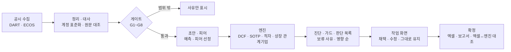

# KVI 밸류에이션 워크벤치

> **English summary.** KVI Valuation Workbench drafts an equity valuation of a Korean listed company from public filings (DART) and Bank of Korea rates, ranks the judgement calls by their per-share impact, and turns the analyst's decisions into a live-formula Excel model and a draft report.
> Run once, without changes, on 50 companies it had never seen: a draft for 47/47 eligible companies, 0 crashes and 0 unsourced numbers — 8 of 13 quality metrics passed, 4 missed (reasons below) and 1 is not measured yet.
> Exchange price data is not included (data terms): users type the prices. Results are illustrative estimates under stated assumptions, not investment advice.

**공개 공시로 상장사 주식가치 초안을 자동으로 만들고(자동 초안), 사람이 판단할 곳을 주당 영향이 큰 순서로 보여 준 뒤(판단 목록), 실무자가 확정하면 수식이 살아 있는 엑셀 모델과 보고서 초안을 내려받는 작업 도구입니다.**

## 데모


- 앱: https://korea-valuation-insights-nadjarrtmvgmg7kxs9ujyy.streamlit.app/ — 한동안 방문이 없으면 앱이 잠들어, 첫 접속 때 깨우는 데 시간이 걸릴 수 있다
- 데모·스크린샷·예시 파일의 시세는 모두 **예시 입력 시세(실제 종가 아님) — 결과는 가정 하의 추정 내재가치 예시**입니다(대상 종가 20,000원, 20일 VWAP 19,800원, 상장 종속회사·관계기업 종가 12,000원)
- 예시 산출물(공개 모드 확정 엑셀·보고서·요약): [examples/](examples/README.md) · 화면 스크린샷: [docs/demo/](docs/demo/README.md)

## 쓰는 법 (3단계)

1. **회사 고르기** — 자동 평가 가능 여부(게이트)와 경로(일반·SOTP·적자 등)를 보고 **평가 시작**. 재무·피어·할인율·DCF·상대가치 초안과 판단 목록이 만들어집니다
2. **판단하기** — 판단 목록(주당 영향 순)에서 후보 값을 채택하거나(버튼마다 '지금 주당 → 반영 뒤 주당'), 직접 입력하거나, 그대로 유지합니다. 바꿀 때마다 버전과 이유가 기록됩니다
3. **확정·내려받기** — 시세(종가·20일 VWAP)를 넣고 **확정** → 수식이 살아 있는 엑셀 모델(엔진 값과 자동 대조)과 보고서 초안(.docx)을 내려받습니다. 처음이면 **예시 값으로 채우기**로 바로 써 볼 수 있습니다

## 검증 결과

앞 단계에서 한 번도 보지 않은 상장사 50곳을 미리 정한 규칙대로 뽑아 **수정 없이 한 번** 돌린 최종 확인 결과입니다(2026-10-23). 금융 1곳·자동 평가 범위 밖 2곳을 뺀 **47곳**이 분모입니다. 13개 지표 중 **통과 8 · 미달 4 · 미측정 1**.

| # | 지표 | 기준 | 결과 | 판정 |
|---|---|---|---|---|
| 1 | 초안 생성률(비금융 − 범위 밖) | ≥ 85% & Wilson 하한 ≥ 70% | 47/47 = 100% [92.4%, 100%] | 통과 |
| 2 | 크래시(처리 안 된 예외) | 0 | 0(단계 실패 0, 작업 화면 뒷단 예외 0) | 통과 |
| 3 | 엑셀 ↔ 엔진 불일치 | 0 | 파이프라인 대조 47/47 일치, 작업 화면 확정 대조 46/47 | **미달(1건)** |
| 4 | 출처 없는 숫자 | 0 | 0(전수 96개 모델: 홀드아웃 초안 47 + 확정 47 + 사람 설정 사례 2) | 통과 |
| 5 | 외부평가의견서 재현 | 20건 각 ±0.5% | 19/20(새 20건, 중앙값 차이 0.014%) | **미달(1건)** |
| 6 | 보류·빨강의 원인 분해·1순위 판단 | 100% | 32/32 | 통과 |
| 7 | 판단 상위 5 주당 영향 비중 중앙값 | ≥ 80% | 78.0%(≥ 80%인 회사 20/47, 90분위 91.9%) | **미달** |
| 8 | 첫 초안(새 회사, 수집 포함) | ≤ 60초 | 중앙값 43.3초 · 90분위 53.7초 · 최대 59.8초 | 통과 |
| 9 | 입력 변경 → 재계산 | ≤ 2초 | 중앙값 0.019초 · 90분위 0.023초 | 통과 |
| 10 | 엑셀 생성(확정 → 엑셀) | ≤ 20초 | 중앙값 18.2초 · 90분위 20.2초 · 최대 24.1초 | 통과(중앙값 기준) |
| 11 | 감사 추적 | 100% | 다시 계산 47/47 일치(확정 전·후), 확정 주당 = 채택 뒤 주당 47/47, 세션 버전 칸 47/47 | 통과 |
| 12 | 메모리 | PC 익명 합 ≤ 1,890MB & RSS 합 ≤ 1,890MB | PC 동시 3건: 전용(익명 대리) 합 최고 2,751MB, RSS 합 최고 1,433MB. 서버: 익명 1,290MB · RSS 합 1,693MB · 재시작 0 | **미달(PC 전용 바이트)** |
| 13 | 보안·운영 | 판매 전 | — | **미측정** |
| — | 대표값 표시율(기록) | 없음 | 30/47 = 63.8% | 기록 |

미달·미측정 이유(고치지 않고 그대로 공개 — 가치 계산 오류가 아니라 허용오차 정의·파서·대리 지표·제품 특성이고, 고치면 확인용 표본을 다시 써야 하므로):

- **엑셀 ↔ 엔진 불일치** (미달(1건)): 계산 차이가 아니라 허용오차 정의: EV가 0에 가까워 비율이 −931로 커진 칸(Exit 기준 영구가치 비중)의 부동소수 잡음, 차이 1.7e-9 > 절댓값 허용 1e-9(상대 1.8e-12). 주당 차이 1.8e-11원, master check OK
- **외부평가의견서 재현** (미달(1건)): 1건(−0.72%)은 영구가치 표의 FCF_N을 FCF_N+1로 읽은 것으로 보임(파서). FCF_N+1 = FCF_N × (1+g)로 두면 +0.007%. 계산 관행·정의 차이, 원문 표 미대조
- **판단 상위 5 주당 영향 비중 중앙값** (미달): 판단 항목이 회사당 중앙값 23개로 늘어 꼬리가 길어짐(피어 하나 빼기·할인율·재투자·수렴). 큰 가정을 판단 목록에 더한 결과로 분모가 넓어짐. 기록: 할인율(WACC) 묶음 비중 85.2%
- **메모리** (미달(PC 전용 바이트)): Windows 전용 바이트는 RSS의 약 2배로 Linux 익명 메모리보다 크게 나온다(대리 지표 한계). RSS·서버 값은 기준 안
- **보안·운영** (미측정): 로그인·권한·접근 기록·백업은 다음 단계(운영·보안)에서 갖춘다

**검증 방식**: ① 표본 뽑는 법·지표·기준을 결과를 보기 전에 커밋(사전 고정) → ② 처음 보는 회사 50곳 → ③ 수정 없이 1회 → ④ 외부 점검 → 수정(이유 기록) → ⑤ 새 표본 50곳으로 재확인. 단계별 숫자와 커밋은 [VALIDATION.md](VALIDATION.md).

**'자동 결과 보류'**: 신뢰할 수 없는 결과는 대표값으로 내보내지 않습니다(틀린 숫자보다 평가 불가). 확인 표본 47곳 중 17곳이 보류였고, 이때도 초안·원인 분해·1순위 판단은 나옵니다.

## 작동 방식



- 평가 방법·문턱 값: [METHODOLOGY.md](METHODOLOGY.md) (A. 가치평가 방법 요약, B. 외부평가 의견서 집계)

## 데이터 출처와 공개 범위

- 재무·공시: DART 전자공시(숫자마다 접수번호 링크). 금리: 한국은행 ECOS
- **한국거래소 시세는 이 저장소와 앱에 없습니다.** 대상 회사 종가·VWAP(그리고 상장 종속회사·관계기업·우선주 종가)은 사용하는 사람이 넣고, 그 값의 책임은 입력한 사람에게 있습니다
- 피어는 이름·포함 여부와 집계값(무부채 베타 중앙값·배수 사분위·목표 D/E)만 담았습니다. 집계값은 포함 피어(또는 D/E 시점)가 5개 이상일 때만, 경영권 프리미엄 구간 표 칸은 10건 이상일 때만 보여 줍니다
- 회사 범위: 개발·검증에 이미 쓴 190곳(평가 가능 158곳 + 자동 평가 범위 밖 32곳). 다른 회사는 PC 모드에서 초안을 만듭니다
- 경영권 프리미엄은 집계(건수·분위수·구간 표)만 담았습니다(거래별 값·거래 이름·거래별 기준 주가 없음)
- 자세히: [DATA_NOTICE.md](DATA_NOTICE.md) · [USAGE.md](USAGE.md)

## 알려진 한계

- 엑셀 ↔ 엔진 대조의 비율 칸 허용오차(절댓값): EV가 0에 가까운 회사에서 비율 칸이 부동소수 잡음만으로 '불일치'로 표시될 수 있다(최종 확인 1건, 차이 1.7e-9)
- 외부평가의견서 파서의 FCF_N+1 정의: 영구가치 표의 FCF_N을 FCF_N+1로 읽으면 재현이 −0.72% 벗어난다(새 20건 중 1건)
- 판단 상위 5 비중 78.0%(기준 80%): 판단 항목이 늘어(회사당 중앙값 23개) 상위 5개 밖에도 영향이 남는다
- PC 메모리 대리 지표: Windows 전용 바이트(2,751MB)는 RSS(1,433MB)의 약 2배라 기준을 넘는다
- 종속회사 이름이 같은 이름의 상장사로 오인됨(대성하이텍): 비상장 종속회사 '디에스엠(구 테크엑스)'을 같은 이름의 상장사로 잘못 연결할 수 있다
- 보고서일 전 결정한 주식병합 미반영(사조씨푸드 → 사조동아원): 기간 안 주식 수 변동 공시가 없으면 보유 수량을 고치지 못한다(10:1 병합으로 보임)

전체(영향·현재 안전장치·계획): [KNOWN_ISSUES.md](KNOWN_ISSUES.md)

## 실행

Python 3.13에서 시험했습니다(새 가상환경에 `requirements.txt`만 설치해 모든 화면 기동 확인).

```
python -m venv venv
venv\Scripts\activate            (macOS·Linux: source venv/bin/activate)
pip install -r requirements.txt
streamlit run app/Home.py
```

작성자: GitHub [Mevius-Skyblue](https://github.com/Mevius-Skyblue) · 라이선스: 코드 [MIT](LICENSE)(데이터는 [DATA_NOTICE.md](DATA_NOTICE.md))

## 면책

투자 권유가 아닙니다. 공개 자료와 정한 규칙으로 계산한 가정 하의 추정 내재가치(예시)이며 특정 종목의 가치·가격에 대한 의견이 아닙니다. 금융투자업(투자자문·투자일임) 등록·신고를 하지 않은 개인 학습·포트폴리오 프로젝트입니다. 정확성을 보증하지 않습니다.
