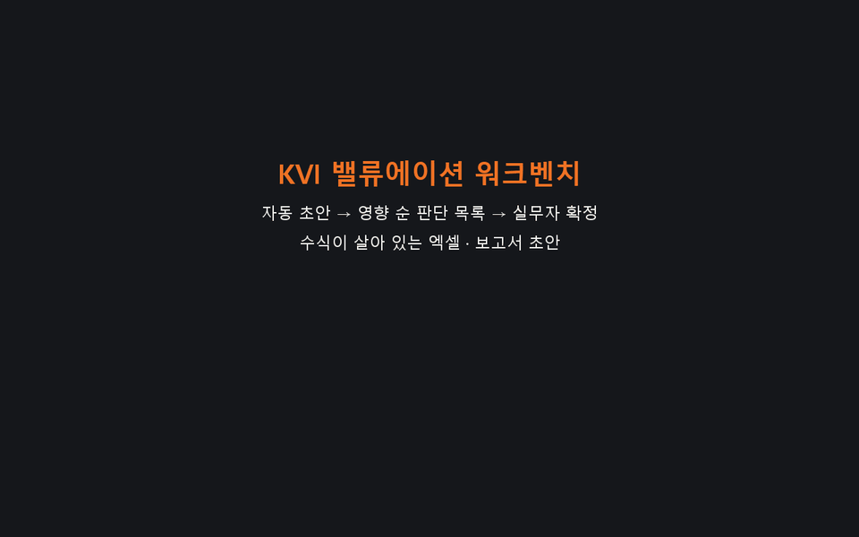
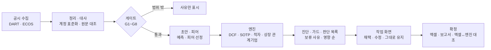

# KVI 밸류에이션 워크벤치

> **English summary.** KVI Valuation Workbench drafts an equity valuation of a Korean listed company from public filings (DART) and Bank of Korea rates, ranks the judgement calls by their per-share impact, and turns the analyst's decisions into a live-formula Excel model and a draft report.
> Run once, without changes, on 50 companies it had never seen: a draft for 44/44 eligible companies, 0 crashes and 0 unsourced numbers — 8 of 13 quality metrics passed, 4 missed (reasons below, published as measured; one check-cell formula error was fixed afterwards without re-measuring) and 1 is not measured yet.
> Exchange price data is not included (data terms): users type the prices. Results are illustrative estimates under stated assumptions, not investment advice.

**공개 공시로 상장사 주식가치 초안을 자동으로 만들고(자동 초안), 사람이 판단할 곳을 주당 영향이 큰 순서로 보여 준 뒤(판단 목록), 실무자가 확정하면 수식이 살아 있는 엑셀 모델과 보고서 초안을 내려받는 작업 도구입니다.**

## 데모



데모 GIF는 이전 화면(단계형)입니다. 지금 화면(KPI 띠 + 작업 탭)은 [docs/demo/](docs/demo/README.md) 스크린샷을 보세요.

- 앱: https://korea-valuation-insights-nadjarrtmvgmg7kxs9ujyy.streamlit.app/ — 한동안 방문이 없으면 앱이 잠들어, 첫 접속 때 깨우는 데 시간이 걸릴 수 있다
- 데모·스크린샷·예시 파일의 시세는 모두 **예시 입력 시세(실제 종가 아님) — 결과는 가정 하의 추정 내재가치 예시**입니다(대상 종가 20,000원, 20일 VWAP 19,800원, 상장 종속회사·관계기업 종가 12,000원)
- 예시 산출물(공개 모드 확정 엑셀·보고서·요약): [examples/](examples/README.md) · 화면 스크린샷: [docs/demo/](docs/demo/README.md)

## 쓰는 법 (3단계)

1. **회사 고르기** — 위 검색창에서 회사를 고르면 자동 평가 가능 여부(통과·보류·제외 + 사유)가 한 줄로 나옵니다. **평가 시작** → 재무·Peer·할인율·DCF·상대가치 초안과 판단 목록. 화면은 KPI 띠 6칸 + 작업 탭 7개(요약·가정·판단·DCF·상대가치·경영권 프리미엄·재무·공시·이벤트)
2. **판단하기** — 가정·판단 탭의 판단 목록(주당 영향 순)에서 후보 값을 채택하거나(버튼마다 '현재 → 반영 후 주당'), 직접 입력하거나, 그대로 유지합니다. 아래 할인율·추정·Bridge 표는 가정마다 1단위 주당 영향을 보여 줍니다. 바꿀 때마다 버전과 이유가 기록됩니다(위 **이력**)
3. **확정·내려받기** — KPI 주가 칸에서 시세(종가·20일 VWAP)를 넣고 위 **확정 · 내보내기** → 보고서 작성 칸 6개·평가 목적을 적고 **확정** → 수식이 살아 있는 엑셀 모델(엔진 값과 자동 대조)·보고서 초안(.docx)·세션 파일. 처음이면 **예시 값으로 채우기**로 바로 써 볼 수 있습니다

## 검증 결과

앞 단계에서 한 번도 보지 않은 상장사 50곳을 미리 정한 규칙대로 뽑아 **수정 없이 한 번** 돌린 최종 재확인 결과입니다(2026-10-23). 금융 3곳·자동 평가 범위 밖 3곳을 뺀 **44곳**이 분모입니다. 13개 지표 중 **통과 8 · 미달 4 · 미측정 1**.

| # | 지표 | 기준 | 결과 | 판정 |
|---|---|---|---|---|
| 1 | 초안 생성률 | ≥ 85%, Wilson 하한 ≥ 70% | 44/44 = 100%(Wilson 95% 92.0\~100%) | 통과 |
| 2 | 크래시 | 0 | 0(단계 실패 0) | 통과 |
| 3 | 엑셀 ↔ 엔진 불일치 | 0 | 파이프라인 44/44 일치, 작업 화면 확정 42/44<br>※ 측정 뒤 수정: 검사 칸 수식(값 불변), 새 표본 재측정 없음 | **미달(2건)** |
| 4 | 출처 없는 숫자 | 0 | 0(전수 90개 모델: 초안 44 + 확정 44 + 사람 설정 사례 2) | 통과 |
| 5 | 외부평가의견서 재현 | 20건 모두 ±0.5% | 17/20(중앙값 \|차이\| 0.007%) | **미달(3건)** |
| 6 | 보류·빨강 원인 분해·1순위 판단 | 100% | 37/37 | 통과 |
| 7 | 판단 상위 5 비중 중앙값 | ≥ 80% | 77.0%(80% 이상 18/44, 90분위 91.1%) | **미달** |
| 8 | 첫 초안 시간 | 중앙값 ≤ 60초 | 48.6초(90분위 62.4, 최대 110) | 통과 |
| 9 | 재계산 | 중앙값 ≤ 2초 | 0.019초(90분위 0.021) | 통과 |
| 10 | 확정 → 엑셀 | 중앙값 ≤ 20초 | 19.06초(90분위 19.76, 최대 20.24) | 통과 |
| 11 | 감사 추적 | 100% | 44/44(확정 전·후 다시 계산 = 같은 결과, 확정 주당 = 채택 뒤 주당, 세션 평가 버전 기록 44/44) | 통과 |
| 12 | 메모리(PC) | 익명 합 ≤ 1,890MB, RSS 합 ≤ 1,890MB | 익명 합 최고 3,422MB, RSS 합 최고 2,048MB(3개 모두 완료·대조 일치) | **미달** |
| 13 | 보안·운영 | 판매 전 | — | **미측정** |
| — | 대표값 표시율(기록) | 없음 | 29/44 = 65.9%(보류 15) | 기록 |

미달·미측정 이유(측정한 그대로 공개 — 남은 미달은 구조적이거나 외부 관행·대리 지표이고, 홀드아웃 반복은 여기서 멈춤. 3번의 검사 칸 수식 오류만 제품 결함이라 측정 뒤 고쳤고, 점수표는 바꾸지 않음):

- **엑셀 ↔ 엔진 불일치** (미달(2건)): 값이 아니라 검사 칸 수식: 채택한 후보로 영구 EBITDA ≤ 0이 되어 'Gordon 함의 EV/EBITDA'가 '계산 불가' 글자가 되자, 확정 모델의 검사 칸 하나가 그 글자를 빼려다 수식 오류(#VALUE!)가 났다. 주당 차이 ≤ 2.4e-11원, master check OK, 9조합 모두 일치
- **외부평가의견서 재현** (미달(3건)): 3건 모두 의견서 계산 관행·표기 차이: 영구가치 기준 현금흐름 정의(FCF_N+1, −0.94%), 영구가치 할인 시점(기간 말 할인, +5.05%), 의견서 안 표시 WACC와 현가계수 WACC 불일치(+4.53%). 나머지 17건 |차이| ≤ 0.08%
- **판단 상위 5 비중 중앙값** (미달): 구조적: 판단 항목 23종의 꼬리(큰 가정을 판단 목록에 더해 분모가 넓어짐). 기록: 할인율(WACC) 구성요소를 한 묶음으로 보면 83.7%
- **메모리(PC)** (미달): 프로세스당 RSS 674\~706MB는 앞 확인과 같은 수준인데, 동시에 시작한 세 작업의 최고점이 겹쳤다(합 2,048 ≈ 프로세스별 최고 합 2,075). Windows 전용 바이트는 RSS보다 크게 나온다(이번 약 1.7배). 공개 서버(2026-10-22 측정)는 익명 1,290MB · RSS 합 1,693MB · 재시작 0
- **보안·운영** (미측정): 로그인·권한·접근 기록·백업은 다음 단계(운영·보안)에서 갖춘다

**검증 방식**: ① 표본 뽑는 법·지표·기준을 결과를 보기 전에 커밋(사전 고정) → ② 처음 보는 회사 50곳 → ③ 수정 없이 1회 → ④ 별도 AI 교차 검토(논리·해석·컴플라이언스) → 수정(이유 기록) → ⑤ 새 표본 50곳으로 재확인. 단계별 숫자·세 홀드아웃 비교·커밋은 [VALIDATION.md](VALIDATION.md).

**'자동 결과 보류'**: 신뢰할 수 없는 결과는 대표값으로 내보내지 않습니다(틀린 숫자보다 평가 불가). 확인 표본 44곳 중 15곳이 보류였고, 이때도 초안·원인 분해·1순위 판단은 나옵니다.

## 작동 방식



- 평가 방법·문턱 값: [METHODOLOGY.md](METHODOLOGY.md) (A. 가치평가 방법 요약, B. 외부평가 의견서 집계)

## 데이터 출처와 공개 범위

- 재무·공시: DART 전자공시(숫자마다 접수번호 링크). 금리: 한국은행 ECOS
- **한국거래소 시세는 이 저장소와 앱에 없습니다.** 대상 회사 종가·VWAP(그리고 상장 종속회사·관계기업·우선주 종가)은 사용하는 사람이 넣고, 그 값의 책임은 입력한 사람에게 있습니다
- Peer는 이름·포함 여부와 집계값(무부채 베타 중앙값·배수 사분위·목표 D/E)만 담았습니다. 집계값은 포함 Peer(또는 D/E 시점)가 5개 이상일 때만, 경영권 프리미엄 구간 표 칸은 10건 이상일 때만 보여 줍니다
- 회사 범위: 개발·검증에 이미 쓴 190곳(평가 가능 158곳 + 자동 평가 범위 밖 32곳). 다른 회사는 PC 모드에서 초안을 만듭니다
- 경영권 프리미엄은 집계(건수·분위수·구간 표)만 담았습니다(거래별 값·거래 이름·거래별 기준 주가 없음)
- 자세히: [DATA_NOTICE.md](DATA_NOTICE.md) · [USAGE.md](USAGE.md)

## 알려진 한계

- 판단 상위 5 비중 77.0%(기준 80%): 판단 항목이 많아(23종) 상위 5개 밖에도 영향이 남는다 — 구조적
- PC 메모리 대리 지표(동시 최고점): 이 PC에서 확정 작업 3개를 동시에 시작하면 최고점이 겹쳐 익명 3,422MB · RSS 합 2,048MB로 기준(1,890MB)을 넘었다
- 확정 → 엑셀 시간(원인 미확인): 중앙값은 기준 안(최종 재확인 19.1초, 90분위 19.8초)이지만 기준과의 여유가 0.9초다. 앞 확인에서는 연속 실행 후반에 늘어 보였으나 같은 프로세스 연속 30곳 측정에서 증가 규칙을 충족하지 않았다
- 분기·연간 기준일 미지원: 엔진·엑셀은 반기 LTM 구조만 지원한다(평가기준일 2026-09-30, 재무 2026-06-30)
- 지주회사 할인은 판단 항목(기본 0%): 상장 종속회사·관계기업 지분은 시가 × (1 − 할인)이고 할인 기본값은 0%
- 보안·운영 미측정: 로그인·권한·접근 기록·백업이 없다(공개 예시 배포)

전체(영향·현재 안전장치·계획): [KNOWN_ISSUES.md](KNOWN_ISSUES.md)

## 실행

Python 3.13에서 시험했습니다(새 가상환경에 `requirements.txt`만 설치해 모든 화면 기동 확인).

```
python -m venv venv
venv\Scripts\activate            (macOS·Linux: source venv/bin/activate)
pip install -r requirements.txt
streamlit run app/Home.py
```

작성자: GitHub [Mevius-Skyblue](https://github.com/Mevius-Skyblue) · 라이선스: 코드 [MIT](LICENSE)(데이터는 [DATA_NOTICE.md](DATA_NOTICE.md))

## 면책

투자 권유가 아닙니다. 공개 자료와 정한 규칙으로 계산한 가정 하의 추정 내재가치(예시)이며 특정 종목의 가치·가격에 대한 의견이 아닙니다. 금융투자업(투자자문·투자일임) 등록·신고를 하지 않은 개인 학습·포트폴리오 프로젝트입니다. 정확성을 보증하지 않습니다.
